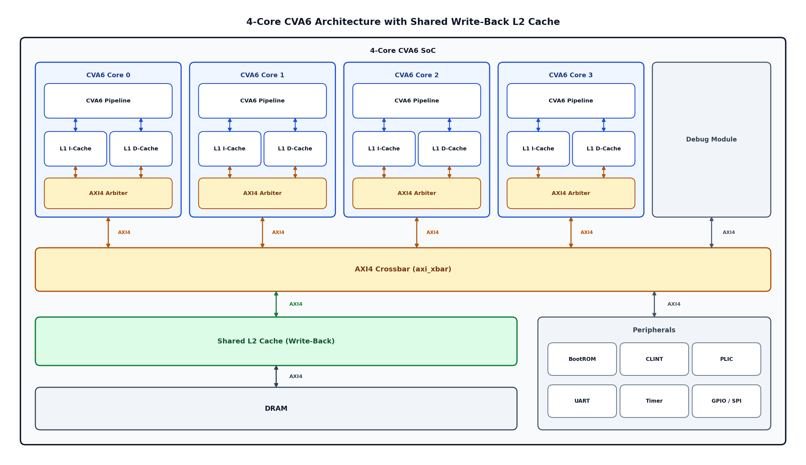
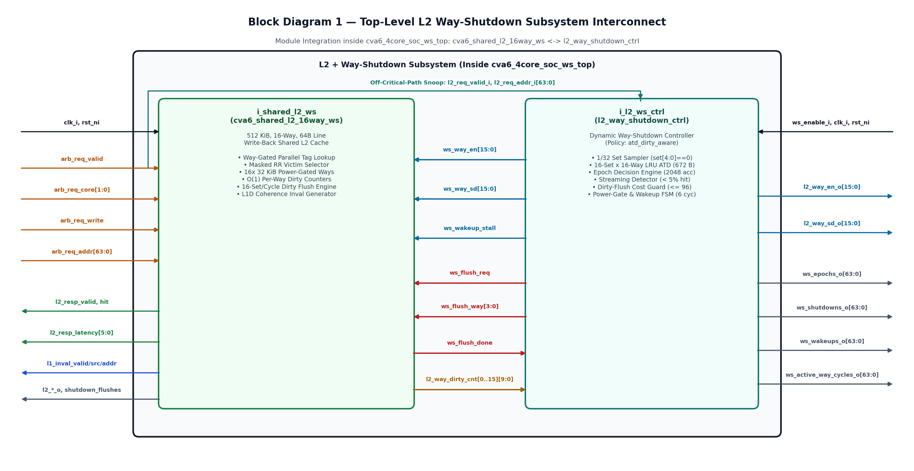

# Gem5xCVA6: 4-Core OpenHW CVA6 with Dynamic Way-Shutdown Shared L2 Cache

Architecture exploration in gem5 (RISC-V) and SystemVerilog RTL implementation in OpenHW CVA6 (Verilator) of a dynamic way-shutdown 512 KiB, 16-way, write-back shared L2 cache for a 4-core CVA6 cluster.

## System Architecture



### Hardware Configuration (`fpga_linux_cv64a6`)

| Component | Parameters |
| :--- | :--- |
| Cores | 4x OpenHW CVA6 (`cva6/core/cva6.sv`, RV64GC, 6-stage in-order, 1 GHz, 16-entry ITLB/DTLB) |
| Private L1I | 16 KiB, 4-way, 128-bit line (`HPIcache`) |
| Private L1D | 32 KiB, 8-way, 128-bit line, write-through (`HPDcache`, `CACHE_WT`, Wbuf=8) |
| Interconnect | 64-bit AXI4 crossbar (`axi_xbar`, 4x CVA6 + Debug Module) |
| Shared L2 | 512 KiB, 16-way (`W0..W15`), 512 sets, 64B line, write-back, 4-cycle hit |
| Way-Shutdown Control | `way_en[15:0]`, `way_sd[15:0]`, 16-set ATD (~672 B tag-only), fast-wakeup miss-spike detector (`>= 24` misses / 256 accesses), miss-rate shutdown guard (`<= 2.5%`), dirty-flush guard (`<= 96`), `T_wakeup = 6 cycles` |
| Power Model | CACTI 7.0 (22nm): 111.73 mW leakage (5.86 mW/way SRAM + 18.04 mW peripheral, 4% gated residual), 19.65 pJ read, 20.81 pJ write, 0.650 nJ/64B DRAM |

## Project Stages

| Stage | Directory | Description | Status |
| :---: | :--- | :--- | :--- |
| Step 1 | [`step1_baseline/`](step1_baseline/) | 12 4-core RISC-V benchmarks on 4-core OpenHW CVA6 + 16-way always-on WB L2 baseline (Verilator 5.036) | Done (12/12 pass) |
| Step 2 | [`step2_gem5_model/`](step2_gem5_model/) | Calibrated 4-core CVA6 + `WayShutdownSetAssoc` in gem5 v26.0, evaluation of 3 control schemes vs static sweep | Done (`atd_dirty_aware`: -0.28% IPC, +20.24% EDP) |
| Step 3 | [`step3_cva6_rtl/`](step3_cva6_rtl/) | SystemVerilog RTL (`atd_dirty_aware`) integrated into 4-core OpenHW CVA6 via AXI4 | Done (12/12 pass, -0.03% IPC, +15.67% EDP) |

## Directory Layout

```text
Gem5xCVA6/
├── README.md
├── env.sh
├── requirements.txt
├── docs/
│   ├── cva6_4core_l2_architecture.png
│   ├── diagram_1_l2_ws_top.png
│   ├── architecture_diagram.md
│   └── architecture_plan.md
├── mcpat_cacti/
│   └── cva6_l2_512k_16w_22nm.cfg(.out)
├── scripts/
│   ├── draw_cva6_4core_l2_arch.py
│   └── draw_rtl_block_diagrams.py
├── step1_baseline/
│   ├── benchmarks/                 # 7 standard (bm01..bm07) + 5 L2-focused (bm08..bm12)
│   ├── run_step1_baseline.sh
│   ├── parse_step1_baseline.py
│   └── results/
├── step2_gem5_model/
│   ├── src/                        # WayShutdownSetAssoc C++ tag store + patch script
│   ├── configs/                    # cva6_4core_l2_way_shutdown.py
│   ├── benchmarks_se/              # 4-core SE-mode wrapper (SYS_clone)
│   ├── scripts/                    # run_step2_gem5_dse.sh, parse_and_plot_step2.py
│   └── results/
└── step3_cva6_rtl/
    ├── rtl/                        # l2_way_shutdown_ctrl.sv, cva6_shared_l2_16way_ws.sv
    ├── scripts/                    # run_step3_rtl_eval.sh, compare_3way_report.py
    └── results/
```

## Evaluated Way-Shutdown Schemes (Step 2)

1. `static`: Fixed number of active ways (`16` baseline; `12, 8, 4, 2` static sweep).
2. `selective_ways`: Miss-rate threshold with hysteresis (disable 2 ways after 2 epochs with `miss_rate < 2%`; enable 4 ways when `miss_rate > 4.5%`).
3. `way_util`: Per-way hit counters per epoch; disables low-hit ways and expands on saturation.
4. `atd_dirty_aware`: 16-set sampled Auxiliary Tag Directory (ATD, ~672 B tag-only) selects the smallest even way count `k*` retaining `>= 98.5%` of 16-way hits (scales to 4 ways when ATD hit rate `< 5%`), gated by a write-back dirty-flush guard (`dirty_cnt[w] <= 96`).

## Step 1: 4-Core OpenHW CVA6 Baseline Results (16-Way Always-On, Verilator 5.036)

See [`step1_baseline/results/step1_baseline_report.md`](step1_baseline/results/step1_baseline_report.md) and [`step1_baseline_summary.csv`](step1_baseline/results/step1_baseline_summary.csv).

| Benchmark | Group | SoC Cycles | L2 Accesses | L2 Misses | L2 Miss Rate | L2 Dirty WB | Total L2+DRAM (nJ) | Checksum |
| :--- | :---: | ---: | ---: | ---: | ---: | ---: | ---: | :---: |
| `bm01_coremark` | Standard | 478,915 | 31,259 | 410 | 1.31% | 0 | 54,417.5 | `0x000000016719032c` |
| `bm02_dhrystone` | Standard | 98,049 | 14,226 | 173 | 1.22% | 0 | 11,360.7 | `0x7ffffffdd83845c7` |
| `bm03_matmul` | Standard | 7,957,496 | 1,146,447 | 3,551 | 0.31% | 0 | 915,124.8 | `0x00000000001ff800` |
| `bm04_spmv` | Standard | 1,513,185 | 226,313 | 3,666 | 1.62% | 0 | 176,019.5 | `0x000000000001e000` |
| `bm05_qsort_rsort` | Standard | 2,128,794 | 317,071 | 4,221 | 1.33% | 0 | 247,097.5 | `0x1a44d44e2dbe23cb` |
| `bm06_vvadd` | Standard | 2,011,638 | 302,131 | 6,224 | 2.06% | 0 | 234,939.6 | `0x0000000295064800` |
| `bm07_memcpy` | Standard | 2,601,344 | 394,476 | 8,352 | 2.12% | 158 | 304,227.1 | `0x000763ee81d14000` |
| `bm08_l2_light_1core` | L2 Custom | 847,517 | 122,664 | 2,896 | 2.36% | 0 | 99,067.7 | `0x1152909a568118ba` |
| `bm09_l2_medium_2cores` | L2 Custom | 1,461,035 | 224,163 | 5,457 | 2.43% | 0 | 171,334.5 | `0x00000006d3cfe329` |
| `bm10_l2_heavy_4cores` | L2 Custom | 2,191,541 | 336,113 | 8,018 | 2.39% | 4 | 256,884.5 | `0x000000019bf22800` |
| `bm11_l2_stream_mix` | L2 Custom | 6,055,098 | 705,028 | 54,112 | 7.68% | 45,904 | 755,881.6 | `0x0000000053a5ca00` |
| `bm12_l2_dynamic_4phases` | L2 Custom | 2,355,144 | 361,988 | 8,577 | 2.37% | 383 | 276,298.8 | `0x000000034a349514` |

## Step 2: gem5 Evaluation (12 Benchmarks x 8 Configs, CACTI 7.0 22nm)

See [`step2_gem5_model/results/step2_gem5_report.md`](step2_gem5_model/results/step2_gem5_report.md) and [`step2_gem5_comparison.csv`](step2_gem5_model/results/step2_gem5_comparison.csv).

| Config | Avg Active Ways (/16) | IPC Change (%) | Avg L2 Miss Rate (%) | Total Dirty Flushes | Avg L2 Leakage (mW) | L2 Leakage Saving (%) | Avg EDP Change (%) |
| :--- | ---: | ---: | ---: | ---: | ---: | ---: | ---: |
| `static16` | 16.00 | +0.00% | 36.03% | 0 | 111.73 | 0.00% | +0.00% |
| `static12` | 12.00 | +0.52% | 44.64% | 0 | 89.24 | 20.12% | +5.31% |
| `static8` | 8.00 | -6.63% | 55.73% | 0 | 66.76 | 40.25% | +0.90% |
| `static4` | 4.00 | -15.61% | 76.09% | 0 | 44.27 | 60.37% | -20.94% |
| `static2` | 2.00 | -16.94% | 87.36% | 0 | 33.03 | 70.44% | -28.24% |
| `selective_ways` | 14.16 | -0.36% | 41.65% | 12,473 | 101.38 | 9.26% | -3.12% |
| `way_util` | 9.76 | -5.94% | 54.10% | 13,624 | 76.67 | 31.38% | -7.08% |
| `atd_dirty_aware` | 11.10 | -0.28% | 38.08% | 157 | 84.17 | 24.67% | +20.24% |


`atd_dirty_aware` was selected for RTL integration: +20.24% average L2+DRAM EDP improvement (positive on all 10 L2-active workloads), -0.28% IPC change, 24.67% average L2 leakage reduction, and 157 total dirty flushes across all 12 benchmarks.

## Step 3: 4-Core OpenHW CVA6 Custom RTL Results (`atd_dirty_aware`)

See [`step3_cva6_rtl/results/step3_3way_comparison.md`](step3_cva6_rtl/results/step3_3way_comparison.md) and [`step3_rtl_summary.csv`](step3_cva6_rtl/results/step3_rtl_summary.csv).

- Functional check: 12/12 pass on 4-core OpenHW CVA6, all checksums match Step 1 baseline.

| Configuration | Avg Active Ways (/16) | 4-Core IPC Change (%) | L2 Leakage Saving (%) | Shutdown Dirty Flushes | Avg EDP Change (%) |
| :--- | ---: | ---: | ---: | ---: | ---: |
| Step 1: OpenHW CVA6 RTL Baseline (16-way) | 16.00 | +0.00% | 0.00% | 0 | +0.00% |
| Step 2: gem5 Model (`atd_dirty_aware`) | 11.10 | -0.28% | 24.67% | 157 | +20.24% |
| Step 3: OpenHW CVA6 RTL (`atd_dirty_aware`) | 12.54 | -0.03% | 17.43% | 345 | +15.67% |


### L2 Way-Shutdown Subsystem Block Diagram



## Build and Run

### Step 1: 4-Core OpenHW CVA6 Baseline RTL
```bash
cd cva6 && make -f corev_apu/tb/Makefile.l2_4core && cd ..
./step1_baseline/run_step1_baseline.sh
```

### Step 2: gem5 Simulation
```bash
.venv/bin/python step2_gem5_model/src/apply_gem5_patch.py
cd gem5 && ../.venv/bin/scons build/RISCV/gem5.fast -j4 --linker=lld && cd ..
make -C step2_gem5_model/benchmarks_se
./step2_gem5_model/scripts/run_step2_gem5_dse.sh
```

### Step 3: 4-Core OpenHW CVA6 + `atd_dirty_aware` RTL
```bash
./step3_cva6_rtl/scripts/run_step3_rtl_eval.sh
```
