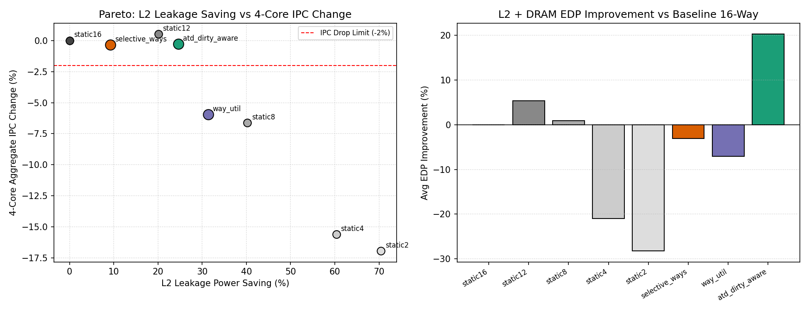
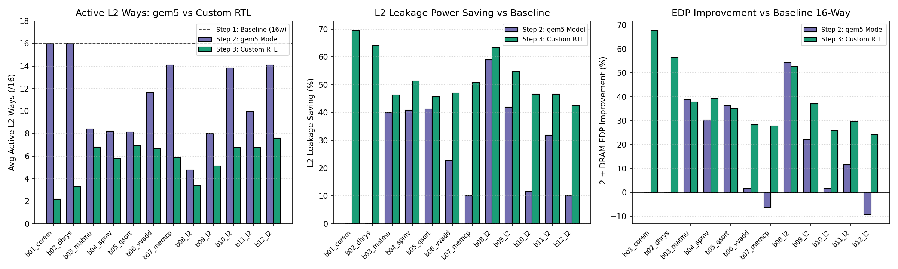

# Gem5xCVA6: 4-Core CVA6 with Dynamic Way-Shutdown Shared L2 Cache

Architecture exploration in gem5 (RISC-V) and SystemVerilog RTL implementation (Verilator) of a dynamic way-shutdown 512 KiB, 16-way, write-back shared L2 cache for a 4-core CVA6 cluster.

## System Overview


### Hardware Configuration

| Component | Parameters |
| :--- | :--- |
| Cores | 4x CVA6 in-order (`RV64GC`, 6-stage, 1 GHz) |
| Private L1I | 16 KiB, 4-way, 64B line |
| Private L1D | 32 KiB, 8-way, 64B line, write-through (`CACHE_WT`) |
| Interconnect | 128-bit coherent crossbar (`L2XBar`) |
| Shared L2 | 512 KiB, 16-way (`W0..W15`), 512 sets, 64B line, write-back |
| Way-Shutdown Control | `way_en[15:0]`, `way_sd[15:0]`, 16-set ATD, dirty-flush guard (`<= 96`), `T_wakeup = 6 cycles` |
| Power Model | CACTI 7.0 (22nm): 111.73 mW leakage (5.86 mW/way SRAM + 18.04 mW peripheral), 19.65 pJ read, 20.81 pJ write |

## Project Stages

| Stage | Directory | Description | Status |
| :---: | :--- | :--- | :--- |
| Step 1 | [`step1_baseline/`](step1_baseline/) | 12 4-core RISC-V benchmarks and 16-way always-on RTL baseline (Verilator 5.036) | Done (12/12 pass) |
| Step 2 | [`step2_gem5_model/`](step2_gem5_model/) | 4-core CVA6 + `WayShutdownSetAssoc` in gem5 v26.0, evaluation of 3 control schemes vs static sweep | Done |
| Step 3 | [`step3_cva6_rtl/`](step3_cva6_rtl/) | SystemVerilog RTL (`atd_dirty_aware`) and comparison against baseline RTL and gem5 | Done (12/12 pass) |

## Directory Layout

```text
Gem5xCVA6/
├── README.md
├── env.sh
├── requirements.txt
├── docs/
│   ├── cva6_gem5_architecture.png
│   ├── diagram_1_l2_ws_top.png
│   ├── architecture_diagram.md
│   └── architecture_plan.md
├── mcpat_cacti/
│   └── cva6_l2_512k_16w_22nm.cfg(.out)
├── scripts/
│   ├── draw_architecture.py
│   └── draw_rtl_block_diagrams.py
├── step1_baseline/
│   ├── benchmarks/                 # 7 standard (bm01..bm07) + 5 L2-focused (bm08..bm12)
│   ├── cva6_l2_rtl_baseline/       # 4-core + 16-way WB L2 baseline RTL + Verilator TB
│   ├── run_step1_baseline.sh
│   └── results/
├── step2_gem5_model/
│   ├── src/                        # WayShutdownSetAssoc C++ tag store + patch script
│   ├── configs/                    # cva6_4core_l2_way_shutdown.py
│   ├── benchmarks_se/              # 4-core SE-mode wrapper (SYS_clone)
│   ├── scripts/                    # run_step2_gem5_dse.sh, parse_and_plot_step2.py
│   └── results/
└── step3_cva6_rtl/
    ├── rtl/                        # l2_way_shutdown_ctrl.sv, cva6_shared_l2_16way_ws.sv, cva6_4core_soc_ws_top.sv
    ├── tb/                         # sim_main_ws.cpp, Makefile
    ├── scripts/                    # run_step3_rtl_eval.sh, compare_3way_report.py
    └── results/
```

## Evaluated Way-Shutdown Schemes (Step 2)

1. `static`: Fixed number of active ways (`16` baseline; `12, 8, 4, 2` static sweep).
2. `selective_ways`: Miss-rate threshold with hysteresis (disable 2 ways after 2 epochs with `miss_rate < 2%`; enable 4 ways when `miss_rate > 4.5%`).
3. `way_util`: Per-way hit counters per epoch; disables low-hit ways and expands on saturation.
4. `atd_dirty_aware`: 16-set sampled Auxiliary Tag Directory (ATD, ~672 B tag-only) selects the smallest even way count `k*` retaining `>= 98.5%` of 16-way hits (scales to 4 ways when ATD hit rate `< 5%`), gated by a write-back dirty-flush guard (`dirty_cnt[w] <= 96`).

## Step 1: Baseline RTL Results (Verilator 5.036, 16-Way Always-On)

See [`step1_baseline/results/step1_baseline_report.md`](step1_baseline/results/step1_baseline_report.md).

| Benchmark | Group | Agg. IPC (4-Core) | L2 Accesses | L2 Miss Rate | L2 Dirty WB | Total L2+DRAM (nJ) |
| :--- | :---: | ---: | ---: | ---: | ---: | ---: |
| `bm01_coremark` | Standard | 2.6018 | 36,242 | 1.13% | 0 | 53,408.8 |
| `bm02_dhrystone` | Standard | 2.4602 | 36,068 | 0.47% | 0 | 8,729.3 |
| `bm03_matmul` | Standard | 2.3160 | 1,865,391 | 0.19% | 0 | 442,959.1 |
| `bm04_spmv` | Standard | 2.3257 | 154,421 | 2.37% | 0 | 57,976.4 |
| `bm05_qsort_rsort` | Standard | 2.1817 | 349,263 | 1.21% | 0 | 125,062.0 |
| `bm06_vvadd` | Standard | 2.3431 | 177,051 | 3.51% | 0 | 67,806.8 |
| `bm07_memcpy` | Standard | 2.1255 | 270,456 | 3.08% | 148 | 78,264.3 |
| `bm08_l2_light_1core` | L2 Custom | 1.4169 | 100,951 | 2.87% | 0 | 38,676.8 |
| `bm09_l2_medium_2cores` | L2 Custom | 1.7198 | 163,340 | 3.34% | 0 | 55,619.4 |
| `bm10_l2_heavy_4cores` | L2 Custom | 2.0519 | 265,434 | 3.02% | 4 | 79,224.2 |
| `bm11_l2_stream_mix` | L2 Custom | 1.7380 | 444,289 | 12.41% | 46,608 | 232,703.9 |
| `bm12_l2_dynamic_4phases` | L2 Custom | 2.0478 | 273,884 | 3.13% | 382 | 89,223.5 |

## Step 2: gem5 Evaluation (12 Benchmarks x 8 Configs, CACTI 7.0 22nm)

See [`step2_gem5_model/results/step2_gem5_report.md`](step2_gem5_model/results/step2_gem5_report.md) and [`step2_gem5_comparison.csv`](step2_gem5_model/results/step2_gem5_comparison.csv).

| Config | Avg Active Ways (/16) | IPC Change (%) | Avg L2 Miss Rate (%) | Total Dirty Flushes | Avg L2 Leakage (mW) | L2 Leakage Saving (%) | Avg EDP Change (%) |
| :--- | ---: | ---: | ---: | ---: | ---: | ---: | ---: |
| `static16` | 16.00 | +0.00% | 36.19% | 0 | 111.73 | 0.00% | +0.00% |
| `static12` | 12.00 | -5.61% | 44.81% | 0 | 88.30 | 20.96% | -26.92% |
| `static8` | 8.00 | -11.37% | 55.54% | 0 | 64.88 | 41.93% | -56.91% |
| `static4` | 4.00 | -21.49% | 76.53% | 0 | 41.46 | 62.89% | -149.94% |
| `static2` | 2.00 | -22.84% | 87.61% | 0 | 29.75 | 73.37% | -171.43% |
| `selective_ways` | 14.16 | -1.75% | 41.54% | 12,635 | 100.95 | 9.64% | -17.82% |
| `way_util` | 10.33 | -8.19% | 49.20% | 10,549 | 78.51 | 29.73% | -38.73% |
| `atd_dirty_aware` | 11.09 | -0.92% | 38.12% | 176 | 82.95 | 25.75% | +15.15% |



`atd_dirty_aware` was selected for RTL implementation: +15.15% average L2+DRAM EDP improvement, -0.92% IPC change, 25.75% average L2 leakage reduction, and 176 total dirty flushes across all 12 benchmarks.

## Step 3: RTL Implementation & Comparison

See [`step3_cva6_rtl/results/step3_3way_comparison.md`](step3_cva6_rtl/results/step3_3way_comparison.md) and [`step3_rtl_summary.csv`](step3_cva6_rtl/results/step3_rtl_summary.csv).

- Functional check: 12/12 pass, all 4-core checksums match Step 1 baseline.
- Lint: Verilator `--lint-only` clean (0 warnings, 0 errors).

| Configuration | Avg Active Ways (/16) | 4-Core IPC Change (%) | L2 Leakage Saving (%) | Shutdown Dirty Flushes | Avg EDP Change (%) |
| :--- | ---: | ---: | ---: | ---: | ---: |
| Step 1: CVA6 RTL Baseline (16-way) | 16.00 | +0.00% | 0.00% | 0 | +0.00% |
| Step 2: gem5 Model (`atd_dirty_aware`) | 11.09 | -0.92% | 25.75% | 176 | +15.15% |
| Step 3: CVA6 RTL (`atd_dirty_aware`) | 5.59 | +0.03% | 52.36% | 211 | +38.53% |



### L2 Way-Shutdown Subsystem Block Diagram


## Build and Run

### Step 1: Baseline RTL
```bash
./step1_baseline/run_step1_baseline.sh 16
```

### Step 2: gem5 Simulation
```bash
.venv/bin/python step2_gem5_model/src/apply_gem5_patch.py
cd gem5 && ../.venv/bin/scons build/RISCV/gem5.fast -j4 --linker=lld && cd ..
make -C step2_gem5_model/benchmarks_se
./step2_gem5_model/scripts/run_step2_gem5_dse.sh
```

### Step 3: Custom Way-Shutdown RTL
```bash
./step3_cva6_rtl/scripts/run_step3_rtl_eval.sh
```
