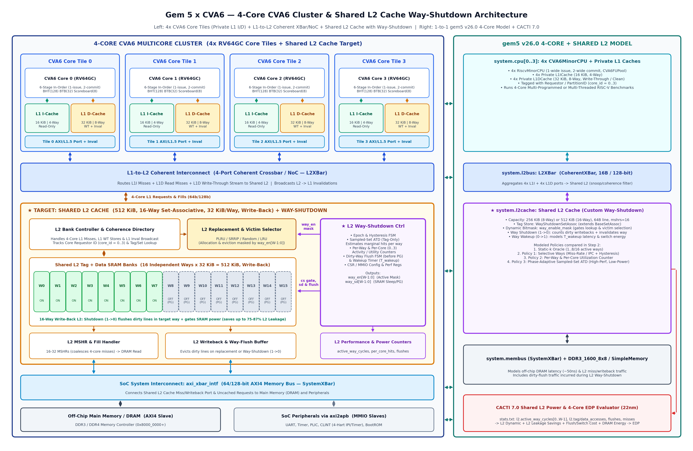

# Gem5 x CVA6 — 4-Core CVA6 + 16-Way Write-Back Shared L2 Cache with Dynamic Way-Shutdown

Design, architectural modeling in **gem5 (RISC-V)**, and RTL hardware implementation in **SystemVerilog (Verilator)** of a **Dynamic Cache Way-Shutdown** controller for a **512 KiB, 16-Way, Write-Back Shared L2 Cache** in a **4-Core CVA6 (RV64GC)** multicore cluster. The primary objective is to significantly reduce L2 static (leakage) and total L2+DRAM energy while keeping 4-core aggregate IPC degradation within **<= 1% - 2%**.

## System Architecture



### Target Hardware Parameters

| Component | Configuration |
| :--- | :--- |
| **Processor Cluster** | 4x CVA6 In-Order Cores (`RV64GC`, 6-stage pipeline, 1 GHz) |
| **Private L1 I-Cache** | 16 KiB, 4-Way, 64B line (per core) |
| **Private L1 D-Cache** | 32 KiB, 8-Way, 64B line, Write-Through (`CACHE_WT`, per core) |
| **Coherent Interconnect** | 128-bit Coherent Crossbar (`L2XBar`) |
| **Shared L2 Cache** | **512 KiB, 16-Way (`W0..W15`), 512 Sets, 64B line, Write-Back** |
| **Way-Shutdown Controller** | `way_enable_mask[15:0]`, Sampled-Set ATD (16/512 sets), Write-Back Dirty-Flush Guard, `T_wakeup = 6 cycles` |
| **Power Model (CACTI 7.0, 22nm)** | Total L2 Leakage = `111.73 mW` (`5.86 mW/way` power-gateable SRAM + `18.04 mW` peripheral); Read = `19.65 pJ`, Write = `20.81 pJ` |

---

## 3-Step Workflow & Status

| Step | Directory | Objective | Status |
| :---: | :--- | :--- | :--- |
| **Step 1** | [`step1_baseline/`](step1_baseline/) | Build 12 4-Core RISC-V benchmarks & run 16-way Always-On RTL Baseline on Verilator 5.036 | Completed (12/12 PASS) |
| **Step 2** | [`step2_gem5_model/`](step2_gem5_model/) | Build 4-Core CVA6 + `WayShutdownSetAssoc` in gem5 v26.0, evaluate 3 dynamic policies vs Static Oracle | Completed (Winner: `atd_dirty_aware`) |
| **Step 3** | [`step3_cva6_rtl/`](step3_cva6_rtl/) | Implement the winning Way-Shutdown policy in SystemVerilog RTL & perform 3-way validation (Baseline RTL vs gem5 vs Custom RTL) | Planned |

---

## Repository Structure

```text
Gem5xCVA6/
├── README.md                             # Project overview, architecture & quick-start guide
├── .gitignore                            # Excludes upstream repos, venv & build artifacts
├── env.sh                                # Environment setup script
├── requirements.txt                      # Python dependencies (scons, numpy, pandas, matplotlib, pyyaml)
├── docs/
│   ├── cva6_gem5_architecture.png        # High-resolution system architecture diagram
│   ├── cva6_gem5_architecture.svg        # Vector SVG architecture diagram
│   ├── architecture_diagram.md           # Mermaid system diagram
│   └── architecture_plan.md              # Architecture specification, 12 benchmarks & Way-Shutdown policies
├── mcpat_cacti/
│   └── cva6_l2_512k_16w_22nm.cfg(.out)   # CACTI 7.0 (22nm) config & output for 512 KiB 16-Way Shared L2
├── scripts/
│   └── draw_architecture.py              # Script to regenerate PNG/SVG architecture diagrams
├── step1_baseline/                       # STEP 1: 12 4-Core Benchmarks & CVA6 L2 RTL Baseline
│   ├── README.md
│   ├── run_step1_baseline.sh             # Automated build & run script for all 12 benchmarks on Verilator
│   ├── benchmarks/                       # 7 standard (bm01..bm07) + 5 L2-targeted (bm08..bm12) benchmarks
│   ├── cva6_l2_rtl_baseline/             # SystemVerilog RTL for 4-Core + 16-Way WB L2 + C++ Verilator TB
│   └── results/                          # step1_baseline_summary.csv & step1_baseline_report.md
├── step2_gem5_model/                     # STEP 2: gem5 Model & Way-Shutdown DSE
│   ├── README.md
│   ├── src/
│   │   ├── way_shutdown_tags.hh          # C++ WayShutdownSetAssoc class (inherits BaseSetAssoc)
│   │   ├── way_shutdown_tags.cc          # 4 policies, 16-set ATD, Dirty-Way Flush & Wakeup logic
│   │   └── apply_gem5_patch.py           # Auto-patches gem5/src/mem/cache/tags/{Tags.py,SConscript}
│   ├── configs/
│   │   └── cva6_4core_l2_way_shutdown.py # gem5 4-Core CVA6 + L2XBar + 512 KiB 16-Way L2 config
│   ├── benchmarks_se/                    # 4-Core SE-mode wrapper (SYS_clone) reusing Step 1 C sources
│   ├── scripts/
│   │   ├── run_step2_gem5_dse.sh         # Automated DSE sweep (12 benchmarks x 8 configs = 96 runs)
│   │   └── parse_and_plot_step2.py       # Stats parser + CACTI 7.0 -> CSV, Markdown & Pareto PNG
│   └── results/                          # Step 2 comparison CSV, report & Pareto plot
└── step3_cva6_rtl/                       # STEP 3: Custom Way-Shutdown RTL & 3-Way Verification
    └── README.md
```

---

## Modeled Way-Shutdown Policies (Step 2)

1. **`static` (Baseline & Oracle):** Keeps a fixed number of `k` ways enabled (`k = 16` for Baseline; sweep `k = 12, 8, 4, 2` for Static Oracle reference).
2. **`selective_ways` (Albonesi Miss-Rate + Hysteresis):** Shuts down 2 ways after 2 consecutive epochs with `miss_rate < 2%`; wakes up 4 ways when `miss_rate > 4.5%`.
3. **`way_util` (Per-Way Hit Counter):** Tracks per-way hit counts per epoch, disabling low-utility ways and expanding when active boundary ways saturate.
4. **`atd_dirty_aware` (Proposed):** Uses a 16-set Sampled-Set Auxiliary Tag Directory (ATD, < 1.5% area overhead) to find the minimum way count `k*` capturing >= 98.5% of full 16-way hits (automatically scaling down to 4 ways during streaming phases), combined with a **Write-Back Dirty-Flush Cost Guard** to avoid energy-negative flushes.

---

## Step 1 Baseline Results (16-Way Always-On RTL, Verilator 5.036)

All 12/12 benchmarks passed (`PASS`) on the 4-core RTL baseline. Full details: [`step1_baseline/results/step1_baseline_report.md`](step1_baseline/results/step1_baseline_report.md).

| Benchmark | Group | Agg. IPC (4-Core) | L2 Accesses | L2 Miss Rate | L2 Dirty WB | Total L2+DRAM (nJ) |
| :--- | :---: | ---: | ---: | ---: | ---: | ---: |
| `bm01_coremark` | Standard | 2.6018 | 36,242 | 1.13% | 0 | 53,408.8 |
| `bm02_dhrystone` | Standard | 2.4602 | 36,068 | 0.47% | 0 | 8,729.3 |
| `bm03_matmul` | Standard | 2.3160 | 1,865,391 | 0.19% | 0 | 442,959.1 |
| `bm04_spmv` | Standard | 2.3257 | 154,421 | 2.37% | 0 | 57,976.4 |
| `bm05_qsort_rsort` | Standard | 2.1817 | 349,263 | 1.21% | 0 | 125,062.0 |
| `bm06_vvadd` | Standard | 2.3431 | 177,051 | 3.51% | 0 | 67,806.8 |
| `bm07_memcpy` | Standard | 2.1255 | 270,456 | 3.08% | 148 | 78,264.3 |
| `bm08_l2_light_1core` | L2 Custom | 1.4169 | 100,951 | 2.87% | 0 | 38,676.8 |
| `bm09_l2_medium_2cores` | L2 Custom | 1.7198 | 163,340 | 3.34% | 0 | 55,619.4 |
| `bm10_l2_heavy_4cores` | L2 Custom | 2.0519 | 265,434 | 3.02% | 4 | 79,224.2 |
| `bm11_l2_stream_mix` | L2 Custom | 1.7380 | 444,289 | 12.41% | 46,608 | 232,703.9 |
| `bm12_l2_dynamic_4phases` | L2 Custom | 2.0478 | 273,884 | 3.13% | 382 | 89,223.5 |

---

## Step 2 gem5 DSE Results (12 Benchmarks x 8 Configurations, CACTI 7.0 22nm)

Full breakdown: [`step2_gem5_model/results/step2_gem5_report.md`](step2_gem5_model/results/step2_gem5_report.md) | [`step2_gem5_model/results/step2_gem5_comparison.csv`](step2_gem5_model/results/step2_gem5_comparison.csv)

| Policy | Avg Active Ways (/16) | IPC Change (%) | Avg L2 Miss Rate (%) | Total Dirty Flushes | Avg L2 Leakage (mW) | L2 Leakage Saving (%) | Avg EDP Improvement (%) |
| :--- | ---: | ---: | ---: | ---: | ---: | ---: | ---: |
| `static16` (Baseline) | 16.00 | +0.00% | 36.19% | 0 | 111.73 | 0.00% | +0.00% |
| `static12` | 12.00 | -5.61% | 44.81% | 0 | 88.30 | 20.96% | -26.92% |
| `static8` | 8.00 | -11.37% | 55.54% | 0 | 64.88 | 41.93% | -56.91% |
| `static4` | 4.00 | -21.49% | 76.53% | 0 | 41.46 | 62.89% | -149.94% |
| `static2` | 2.00 | -22.84% | 87.61% | 0 | 29.75 | 73.37% | -171.43% |
| `selective_ways` | 14.16 | -1.75% | 41.54% | 12,635 | 100.95 | 9.64% | -17.82% |
| `way_util` | 10.33 | -8.19% | 49.20% | 10,549 | 78.51 | 29.73% | -38.73% |
| **`atd_dirty_aware`** | **11.09** | **-0.92%** | **38.12%** | **176** | **82.95** | **25.75%** | **+15.15%** |


**Selected Design for Step 3 RTL:** `atd_dirty_aware` — the only policy achieving positive L2+DRAM EDP improvement (**+15.15%** average, up to **+54.39%** on light L2 workloads) with **< 1% IPC loss** (**-0.92%**), **25.75%** average L2 leakage saving (up to **58.96%**), and **98.6%** fewer dirty writeback flushes than `selective_ways`.

---

## Quick Start

### 1. Run Step 1 (Verilator RTL Baseline)
```bash
./step1_baseline/run_step1_baseline.sh 16
```

### 2. Run Step 2 (Patch & Build gem5, then Run Full DSE)
```bash
# Apply WayShutdownSetAssoc patch into gem5 source tree
.venv/bin/python step2_gem5_model/src/apply_gem5_patch.py

# Build gem5 (RISC-V target)
cd gem5 && ../.venv/bin/scons build/RISCV/gem5.fast -j4 --linker=lld && cd ..

# Build 12 SE-mode 4-core RISC-V benchmarks and run full DSE (12 benchmarks x 8 configs)
make -C step2_gem5_model/benchmarks_se
./step2_gem5_model/scripts/run_step2_gem5_dse.sh
```
