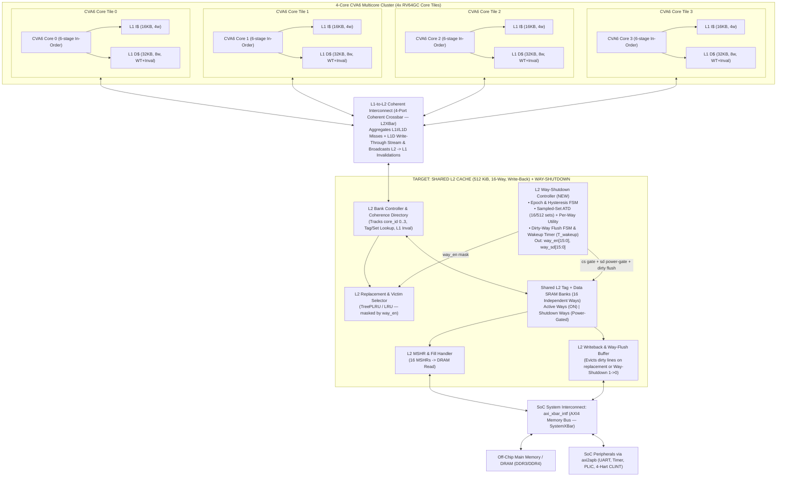

# 4-Core CVA6 Cluster & Shared L2 Cache Way-Shutdown Architecture — Gem5 x CVA6

- High-resolution PNG diagram: [cva6_gem5_architecture.png](cva6_gem5_architecture.png)
- Vector SVG diagram: [cva6_gem5_architecture.svg](cva6_gem5_architecture.svg)

## Mermaid System Diagram (4x CVA6 Core Tiles + Shared L2 Cache Way-Shutdown)

